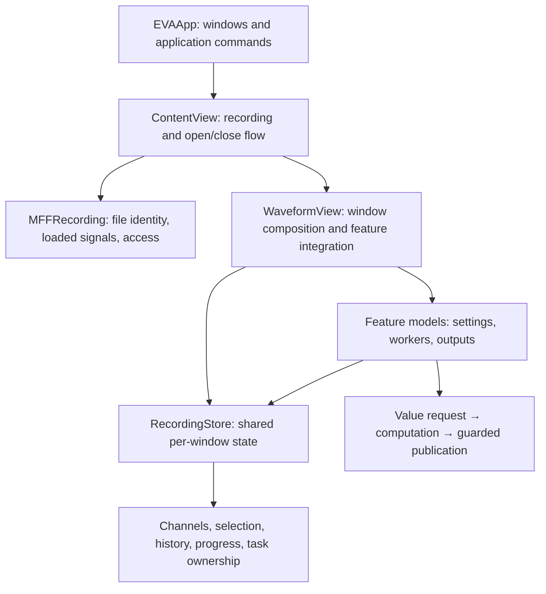

# Data, ownership, and the life of a recording

**Goal:** explain what a processing function receives, who owns its results, and
why finishing an asynchronous calculation does not always permit publishing it.
Read [the first-day walkthrough](setup.md) first. Use the [feature map](features.md)
to follow a particular operation after this chapter.

## Start with a tiny recording

Imagine two channels sampled at 1,000 Hz for one second:

```text
data[0] = [ 2,  3, -1, ... ]  // 1,000 samples from channel 0
data[1] = [-4,  0,  5, ... ]  // 1,000 samples from channel 1
```

The outer array indexes channels; the inner array indexes time samples. For this
example `data[1][250]` is the second channel at 0.250 seconds. There are 1,000
samples, but the last sample's timestamp is 0.999 seconds. Do not interchange
sample count divided by rate (duration) and last sample index divided by rate.
Swift arrays are zero-based; UI channel numbers and file sensor identifiers may
use other conventions. A label such as `E1` is not an array index.

The actual container is [`MFFSignalData`](../../EVACore/IO/MFFReader.swift).
Its historical name does not restrict it to MFF input: other readers normalize
their results into the same type. Its initializer does not validate every
possible malformed array. Readers and engines must enforce the shapes they
require before indexing. [`SignalSelection`](../../EVA/Core/SignalSelection.swift)
shows explicit handling of out-of-range indices and ragged arrays.

| Concept | Representation and rule | Where to inspect |
| --- | --- | --- |
| EEG amplitude | Samples are `Float`; processing and plots generally expect microvolts. Normalize a new reader's units once at its boundary. | `MFFSignalData`, format readers, `WaveformScaleUnits` |
| Peripheral channels | Separate optional PNS signal with its own sample rate, channel units, and polarity metadata. Never assume its timing or units equal EEG. | `ImportedRecording.pnsSignal`, `MFFRecording.pnsSignal` |
| Events | `MFFEvent.beginTimeSeconds`, optional duration, and explicit `timeAnchor`. An event can refer to onset or another anchor; converting to samples needs the chosen rate and rounding policy. | `MFFEvent`, `EventTimeAnchor`, `EventTimeAnchorTests` |
| Epochs | `EpochSegment` uses inclusive `startSample`/`endSample`; length is `end - start + 1`. `stimulusOffsetSamples` locates the event within the epoch. | [EpochModel](../../EVACore/Epoching/EpochModel.swift) |
| Slices/ranges | Swift `a..<b` excludes `b`; convert an inclusive epoch end deliberately before slicing. | Segmentation and export code |
| Acquisition gaps | `acquisitionSkipRanges` describe missing samples; algorithms may need to process recorded runs separately. Zero-filled gaps are not measured flat EEG. | `MFFSignalData.recordedRanges`, filter gap handling |
| Geometry | Channel order must match geometry/lead-field order; coordinates also have a frame and unit. Labels alone do not prove alignment. | `ElectrodeGeometry`, `HeadTransform`, forward-model types |

## Identity, value copies, and cache validity

`MFFSignalData` is a struct. Assigning it copies a value; Swift arrays can share
storage until a mutation requires a copy. This is why history can retain several
signals without immediately duplicating every sample buffer. It does not make
a mutable class captured by a task into a snapshot.

The signal's `dataRevision` identifies a sample-data version. A normal value
copy keeps it; `replacingSamples` creates a new revision and checks that the
channel/sample shape remains compatible with preserved metadata.
`replacingEvents` preserves the sample revision because samples did not change.
`reconstructingTimeline` is the distinct operation for changing a timeline and
its corresponding events/epochs. Read these helpers before constructing a
replacement manually: dropping metadata can be as damaging as wrong numbers.

A cache key needs all inputs that affect its result. A sample revision alone
cannot represent changed event definitions, channel exclusions, geometry, or
algorithm settings. For example, the waveform view combines revisions with
feature-specific request signatures for its `.task(id:)` work. Do not reuse a
revision to make a cache appear valid after changing samples.

## Who owns what?



[`ContentView`](../../EVA/App/ContentView.swift) owns the optional current
recording. [`MFFRecording`](../../EVA/IO/MFFRecording.swift) is an observable
class, not a `FileDocument`; it manages loading, channel-role overrides, and
security-scoped access. [`WaveformView`](../../EVA/Waveform/WaveformView.swift)
constructs one [`RecordingStore`](../../EVA/App/RecordingStore.swift) and injects
that **same instance** into its feature models. Accidentally creating a new
store per model gives the filter and channel UI different bad-channel lists.

The store owns shared channel/selection/display state, history, progress, and
export/history task runners. Feature models own feature settings and computed
outputs. A sheet's short-lived disclosure state can stay in that sheet; a
recording's channel decisions cannot. App preferences (`@AppStorage`) outlive a
window and may be shared across windows. See [the ownership guide](architecture-layers.md)
and [the display-option recipe](recipes/display-option.md).

## Trace open → process → publish

1. **Open.** The app's open command creates a recording window. Import checks
   the URL, obtains required file access, and delegates to
   [`SignalImportReader.load`](../../EVA/IO/SignalImportReader.swift). A reader
   returns signal data and optional layout, geometry, and PNS. Import errors
   should describe the offending file/variant, not produce plausible empty data.
2. **Prepare.** The filtering UI chooses the current upstream signal and
   captures the recording-session identity. `FilterViewModel.apply` validates
   cutoffs, captures parameters into local values, and starts its worker.
   Changing a control later must not change that in-flight request.
3. **Compute.** The UI-independent filter works on arrays. `async` means a
   function can suspend; it does not itself guarantee a background thread.
   Follow the actual worker/task creation and actor annotations.
4. **Publish.** The filter checks request identity and cancellation before
   installing a result. Its caller also guards session-sensitive callbacks.
   A successful numerical calculation for a closed/replaced recording is not
   permission to update the new recording.
5. **Invalidate and record.** `FilteringViews.postFilterInvalidation` calls the
   shared downstream invalidation policy. The history integration records a
   processing step and stage-output snapshot after a committed change. UI
   redraws and progress updates do not each deserve a history node.

For exact entry points, follow [the filtering trace](getting-started.md#follow-a-filter-from-click-to-history).

## Cancellation and stale work are different problems

Consider two requests: A starts, B supersedes it, B finishes, A finishes last.
Cancellation asks A to stop, but code must cooperate. A may already have
finished a non-cancellable library call. An identity check prevents A from
publishing even when cancellation arrives too late.

[`LatestOnlyRunner`](../../EVA/Pipeline/LatestOnlyRunner.swift) owns publication
rights using generations. `.completed` may publish; `.superseded` must not
publish **or clear B's progress**; `.cancelled` with no successor may clean up
without publishing. `invalidate()` disowns work; it does not stop the worker.
The caller still owns task cancellation and stable input capture. Other models,
including filtering, implement request identities directly; do not assume every
worker uses this helper.

Read [`LatestOnlyRunnerTests`](../../EVATests/Pipeline/LatestOnlyRunnerTests.swift):
the gate explicitly holds A until B has claimed ownership. This is more reliable
than assuming a short sleep determines task scheduling. The
[debugging handbook](debugging.md) turns this into an investigation exercise.

## Close, reopen, and restore

`WaveformView.tearDownRecordingSessionForClose` changes `recordingSessionID`,
cancels in-flight tasks, clears recording-specific state, and tears down file
access. `ContentView.closeRecording` also removes registry state and releases
the recording. Reopening a file is a new object/lifecycle, not permission for a
previous task to reuse the old model. Forks explicitly transfer history seed
information and reopen the file; inspect `PendingWindowForks` and history tests
before changing that flow.

[`PipelineSnapshot`](../../EVA/Pipeline/PipelineSnapshot.swift) holds stage
outputs and channel decisions for fast in-session navigation. It deliberately
does not duplicate all view-model parameters: those are restored from the
history path's processing steps. [`EVAProcessingScript`](../../EVACore/Pipeline/EVAProcessingScript.swift)
is the portable ordered script saved in `eva.xml`; learned matrices/templates
may need separate compatible payloads. Reopening an exported processed file is
not equivalent to retaining the entire in-memory history of its original window.
See [history and replay](history-and-replay.md) and [compatibility](compatibility.md).

## Check your understanding

Run `SignalSelectionTests`, `LatestOnlyRunnerTests`, and `PipelineSnapshotTests`
using the commands in [testing](testing.md). Fixture/GPU requirements differ by
suite; a passing small suite does not establish all lifecycle behavior.

Without editing code, answer: which revision changes when only events change?
Who owns bad-channel decisions? Why must A not clear B's spinner? Which metadata
must be rebuilt when concatenating two recordings? Use the named source files
to justify each answer. Then trace one feature from [the map](features.md) and
identify its snapshot, worker, publication guard, invalidation, and tests.
