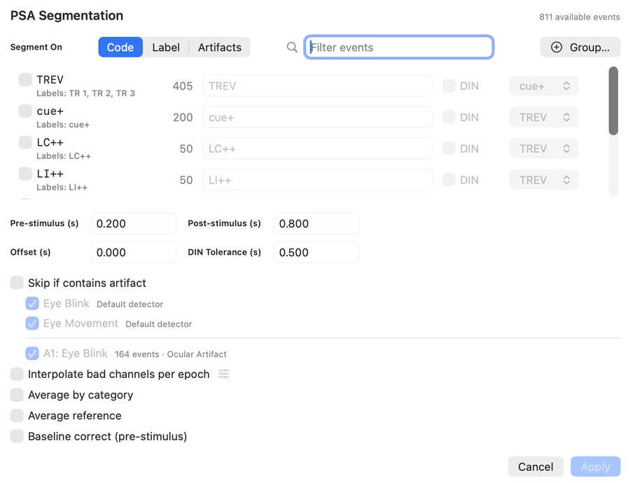
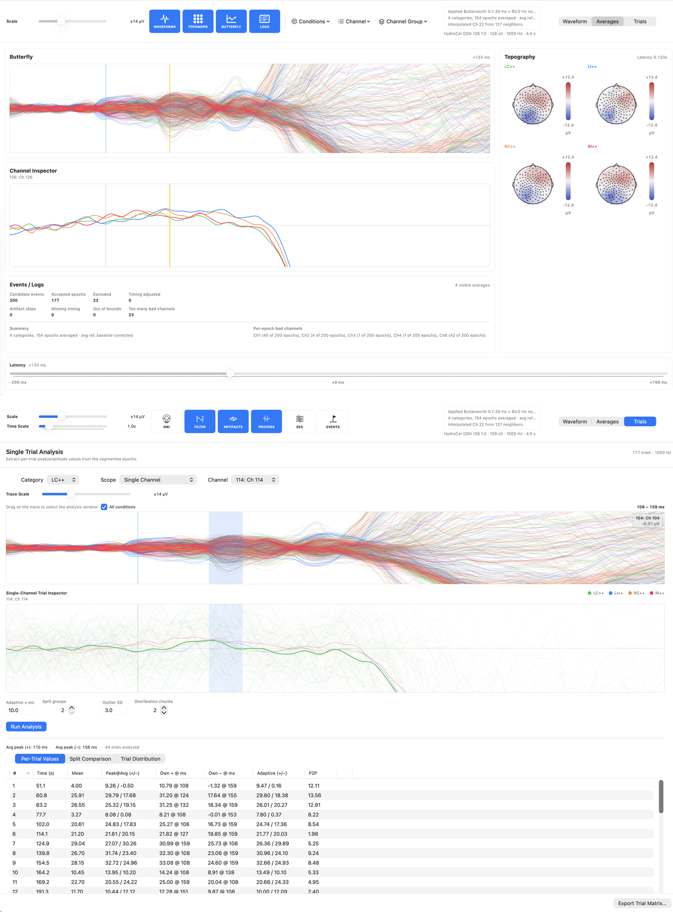

# Epochs And Averages

EVA can segment recordings around events, compute category averages, and support single-trial analysis.

## Create Epochs

When creating epochs, choose:

- Event categories
- Time window around each event
- Baseline interval
- Whether to apply average reference
- Inclusion or exclusion rules for bad channels and artifacts

## Review Epochs In The Decision Matrix

After PSA segmentation, the Decision Matrix opens as a compact floating window
above the epoched waveform, starting in Overview. Use **Processing → Show/Hide
Decision Matrix** to toggle it. Hiding or closing the window preserves the review.
The floating window remembers its position and size, including across launches.
Opening **Configure…**, cancelling, and then showing the matrix again reuses
the existing review and health evidence. Artifact-rule edits update decisions
without rescanning health; real signal, reference, baseline, or detector-threshold
changes still refresh the affected evidence.
New matrices start with the most recently used layout; each open recording keeps
its own window placement. A restored window is kept on an available screen when
the monitor setup changes.

With **Average by category** checked, leave **Use Decision Matrix** unchecked for
the usual direct averaging. Checking both keeps the guided PSA review sheet
(Configure → Review decisions → Average); it does not open the floating window.

- Click a cell to jump to its channel and epoch in the waveform and inspect its
  evidence in a docked details pane. The PSA review sheet uses the same pane,
  without waveform navigation. No second click or selection pop-up is needed.
  Drag the divider to resize the pane, or use **Hide Details** to recover matrix space.
  The compact pane prioritizes the outcome, exclusion reasons, and Cell/Epoch
  controls. Expand **Artifacts** or **Health & measurements** for event timing,
  correction evidence, and detailed scores. **Whole channel…** applies a decision
  across epochs; **Cell** applies only to the selected channel/epoch pair.
- Hover over an epoch-health badge or channel-health strip for a small health
  summary, without selecting anything. This works in Overview and the pinned
  Detail headers, including after sorting or scrolling.
- **Max interpolated / epoch** adjusts the number of channels allowed to be
  repaired in each epoch. Counts and exclusions update immediately using the
  cached evidence, and averaging uses the same limit. Raising it can rescue an
  epoch rejected by the original count limit, but does not bypass artifact rules,
  epoch-health thresholds, electrode-position requirements, or spatial safety checks.
- Click a channel or epoch header to navigate; drag headers to select ranges.
- Drag a rectangle in Overview to zoom or act on an area. The details pane shows
  kept/excluded epoch counts and rejection reasons (which can overlap).
  Keep or interpolate just the selected cells, or keep/reject the selected whole
  epochs. Keeping cells alone does not override an epoch exclusion. Sorting changes
  the display order while decisions remain attached to the original trials.
- Rejected trials stay in the epoched view, with red health shading and a red
  epoch-health strip. They are excluded when you press **Average N Epochs**.
- Blue cells indicate planned interpolation; purple indicates an applied
  artifact correction. The legend remains available above the matrix.
- Option-click the epoch's health band in the waveform to edit its epoch
  decision or interpolate the channel under the pointer in that epoch. These
  controls and the matrix share the same decisions, so counts, cell colors and
  exclusion shading update immediately. A later manual edit takes precedence.
  The channel-label menu's recording-wide interpolation remains a separate action.

Reopening the matrix after averaging returns to the complete source epoch set,
so a rejected trial can be inspected and kept in a new average. Changing a
reference or baseline setting refreshes the evidence while preserving manual
decisions.

## Inspect Averages

After averaging, inspect the result as:

- Channel waveforms
- Butterfly plots
- Topographic maps
- Category overlays

## Single-Trial Analysis

Single-trial tools can extract peak and amplitude values from selected channels and windows. Use these exports for downstream statistics when trial-level variability matters.

Before exporting, confirm:

- The measurement window matches the component of interest.
- Baseline choices are consistent.
- Rejected or cleaned trials are handled consistently.

For phase-persistence analysis and individualized frequency bands, continue with
[Explore Rhythmicity With Trials And Averages](../tutorials/rhythmicity-trials-averages.md).
